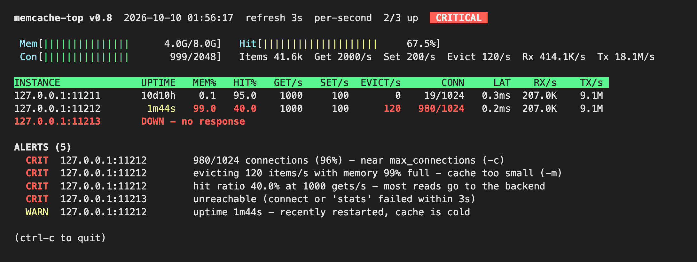

memcache-top
============

"top" for memcache - watch the traffic and other stats in real-time, and see
at a glance when an instance is actually in trouble.  In the style of htop
and glances.

Single Perl script, core modules only.  Speaks the memcached ``stats``
command on port 11211.  Written against memcached v 1.2.3, but works fine
w/ later versions.

USAGE
-----

::

   ./memcache-top                                 # 127.0.0.1:11211, refresh 3s
   ./memcache-top --instances mc1,mc2:11212 --sleep 5
   ./memcache-top --bytes                         # add RX/s and TX/s columns
   ./memcache-top --oneoff                        # exit 0 OK, 1 WARNING, 2 CRITICAL

   - Specify instances w/ --instances (multiple times or comma separated)
   - Specify default port w/ --port (defaults to 11211)
   - Specify sleep time w/ --sleep (default 3), or as a bare number
   - Specify color output w/ --color (default) or --nocolor
   - Specify lifetime stats (averaged over server uptime) w/ --lifetime
   - Specify read and write bytes columns w/ --bytes or --nobytes (default)
   - Specify get and set columns w/ --commands (default) or --nocommands
   - Specify cumulative numbers (since start of run) w/ --cumulative
   - Run a single time without clearing the screen, good for scripts and
     monitoring checks (cron, Nagios, Zabbix): --oneoff

WHAT IT FLAGS
-------------

   - CRIT: instance unreachable
   - CRIT: rejecting connections (max_connections reached)
   - WARN/CRIT: connections near max_connections
   - WARN/CRIT: evictions, shown with how full memory is
   - WARN/CRIT: low hit ratio, only above 10 gets/s so idle instances
     don't cause noise
   - WARN: recently restarted, cache is cold
   - WARN/CRIT: slow 'stats' round-trip

   A full cache alone is not flagged: memcached is meant to fill up and
   evict by LRU.  Evictions are what tell you it is too small.

   Hit ratio and rates are per refresh interval, measured on a persistent
   connection.  The first screen shows ``-`` until there are two samples.

THRESHOLDS
----------

   Edit %limit at the top of the script.  Each metric has a warning
   (yellow) and critical (red) level::

      evictions => [1, 50],      # evictions per second
      hit_ratio => [80, 50],     # % of gets that hit
      conn_pct  => [80, 95],     # curr_connections as % of max_connections
      latency   => [50, 250],    # ms for one 'stats' round-trip
      mem       => [90, 98],     # % of limit_maxbytes; color only

   Watching an instance over a WAN?  Raise ``latency`` above your network
   round-trip, or it will always show yellow or red.
